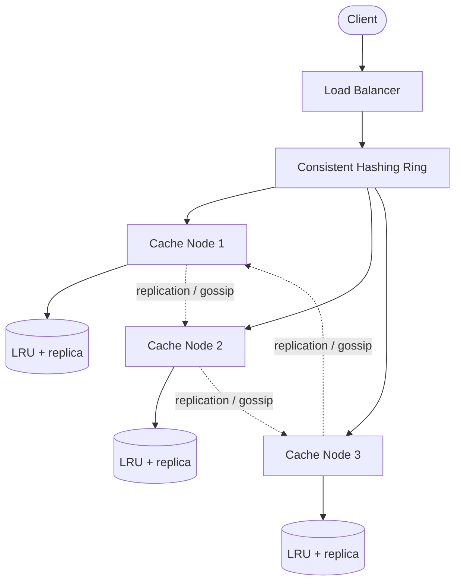

# Case Study: Distributed Cache

Try it yourself first using the [blank template](../templates/design-template.md). Then compare.

## 1. Requirements

**Functional**
- `get(key)` — return value for a key, or miss
- `put(key, value, ttl)` — store a value with optional time-to-live
- `delete(key)` — remove a key
- Automatic eviction when memory is full

**Non-functional**
- Sub-millisecond read/write latency at p99
- High availability: survive a node failure without losing all cached data
- Linear scalability: add nodes to add memory and throughput
- Eventually consistent is acceptable (cache is a performance layer, not source of truth)

Out of scope for this round: transactions, multi-key operations, range queries, persistence to disk (purely in-memory cache), complex data structures beyond strings.

## 2. Estimation

- 100 million keys, average 500 bytes per key-value pair (including metadata)
- 50 GB working set in memory
- 100,000 requests/s average, 500,000/s peak (read-heavy, 90:10 read:write)
- Each cache node: 32 GB RAM, ~28 GB usable for data after overhead → ~2 nodes for data plus replicas

Conclusion: throughput and memory are the concerns; use consistent hashing to spread keys across nodes, replicate each key for HA, and evict with LRU.

## 3. API

```
GET    /v1/cache/{key}
       returns: { "value": "...", "ttl_remaining": "..." } or 404

PUT    /v1/cache/{key}
       body: { "value": "...", "ttl_seconds": 3600 }
       returns: 200 OK

DELETE /v1/cache/{key}
       returns: 204 No Content
```

A client-facing API is optional; many distributed caches use a binary protocol (memcached/Redis-style) over TCP. The HTTP version above is for interview clarity.

## 4. Data model

Access patterns:
- Point lookup by key (get/put/delete)
- Expire keys by TTL (background or lazy)
- Evict least recently used keys when node is full

| Field | Notes |
|-------|-------|
| key | Partition key; hashed to pick a cache node |
| value | Opaque blob |
| ttl | Expiry timestamp |
| version | For cache invalidation / CAS operations |
| last_accessed | For LRU eviction |

Storage choice: in-memory hash map per node plus LRU eviction list. No relational database — the cache is purely a performance layer. Persistence is optional (RDB/AOF snapshots for warm restarts).

## 5. High-level design



```text
Client -> Load Balancer -> Consistent Hashing Ring -> Cache Node 1 (LRU + replica)
                                                   -> Cache Node 2 (LRU + replica)
                                                   -> Cache Node 3 (LRU + replica)
                                               |
                                       Replication / Gossip for membership
```

**Write path (put):** client → LB → hash key → responsible node → store in memory + replicate to N-1 follower nodes → ack.

**Read path (get):** client → LB → hash key → responsible node → return value if present and not expired, else miss.

**Replication:** leader-follower per shard or leaderless quorum (W out of N writes, R out of N reads). For a cache, asynchronous replication is usually fine — losing a few cached entries on failover is acceptable.

**Eviction:** each node runs LRU independently. When memory is full, evict the least recently used keys. TTL expiry is checked lazily (on read) plus a background sweep.

## 6. Deep dive: partitioning and eviction strategy

This is the hard part. How do we spread keys evenly and decide what to evict?

| Decision | Options | Tradeoff |
|----------|---------|----------|
| Partitioning | `hash(key) % N` vs consistent hashing with virtual nodes | Simple mod-N is easy but nearly all keys move when a node is added/removed; consistent hashing moves only neighboring keys |
| Eviction | LRU vs LFU vs FIFO | LRU is the default answer (good temporal locality); LFU for stable popularity; FIFO is simplest but ignores access pattern |
| Replication | Leader-follower sync vs async vs leaderless quorum | Sync is safest but slows writes; async is fast but can lose recent entries on failover (acceptable for cache); quorum balances |
| Hot key | Replicate hot keys to more nodes vs local in-process cache | More replicas spread read load but use more memory; local cache avoids network hop for top keys |

**Recommended:** Consistent hashing with virtual nodes (dozens to hundreds of vnodes per physical node) for even load and graceful rebalancing. LRU eviction per node. Async replication to N-1 followers per shard. For hot keys, add a small local in-process cache on each app server for the top N keys.

**Consistent hashing ring:** place nodes and keys on a ring (0 to 2^32-1). A key belongs to the next node clockwise. When a node is added, only keys between it and its predecessor move. Virtual nodes ensure even distribution and let larger machines own more ring positions.

## 7. Bottlenecks and tradeoffs

- **Hot key:** One key hammered by many clients overloads its cache node. Mitigation: local in-process cache for top keys, key splitting (add random suffix), or replicate the hot key to more nodes.
- **Cache miss stampede:** Many requests miss at once and all hit the database. Mitigation: request coalescing (single DB fetch shared by all waiters), jittered TTLs, or a lock per key.
- **Node failure:** If a node dies, its keys are temporarily unavailable until replication catches up or requests route to replicas. Mitigation: replicate to N-1 nodes; route reads to followers; fail fast with a fallback to DB.
- **Rebalancing:** Adding/removing nodes moves keys. Consistent hashing with vnodes makes this gradual instead of a big migration.
- **Memory pressure:** If the working set exceeds memory, eviction rate rises and hit rate falls. Mitigation: add nodes, increase TTLs for cold data, or shrink the working set.
- **Year 3 growth:** Key count and QPS grow; add nodes linearly. Rebalance gradually with vnodes. Monitor hit rate per node and add capacity before eviction spikes.
- **Monitoring and alerts:** Track hit rate, eviction rate, memory utilization, replication lag (leader vs follower), and get/put latency (p99). Page on hit rate dropping below SLO or memory above threshold.

## Follow-up questions to practice

1. How do you handle cache invalidation when the database changes?
2. What happens if two clients `put` the same key concurrently?
3. How do you support `get_many` (batch get) efficiently?
4. How do you handle a node becoming slow (straggler) without timing out all requests?
5. Would you use Redis or build this from scratch, and why?
