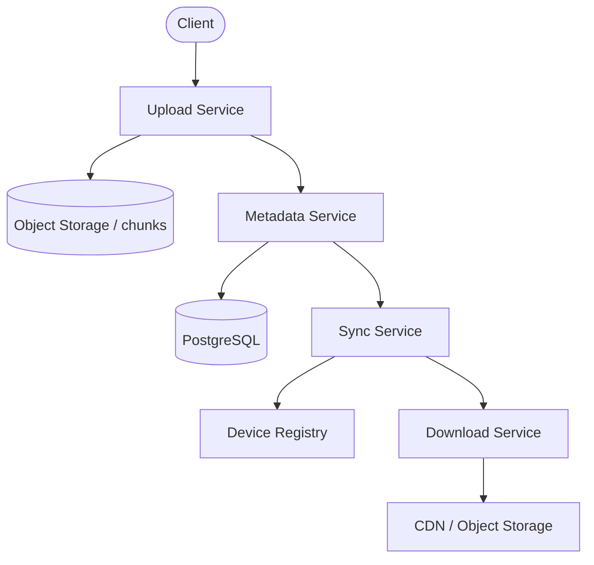

# Case Study: File Storage and Sync

Try it yourself first using the [blank template](../templates/design-template.md). Then compare.

## 1. Requirements

**Functional**
- Upload and download files of any size
- Sync files across multiple devices (a change on one device appears on others)
- Version history: restore previous versions of a file
- Access files from web, mobile, and desktop clients

**Non-functional**
- Durability: uploaded files are never lost
- High availability: upload/download keep working during a single zone failure
- Eventual consistency is acceptable for sync (a few seconds of lag across devices is fine)
- Support large files (GBs) with resumable uploads

Out of scope for this round: real-time collaborative editing, shared folders with permissions, file locking, trash/recycle bin, search within file contents.

## 2. Estimation

- 10 million DAU, each user uploads 5 files per day
- 50M uploads/day → ~600 writes/s average, ~2,500/s peak
- Average file size: 10 MB (mix of docs, photos, small videos)
- Realistic active storage: ~1 PB, growing ~200 TB/month; with 3x replication ~600 TB
- Download volume: assume each file downloaded 3× → ~1.5 PB/month egress

Conclusion: storage and bandwidth dominate. Use object storage for blobs, content-addressable chunking for dedup, and a metadata service for file state. Sync uses eventual consistency.

## 3. API

```
POST   /v1/files/init
       body: { "file_name": "...", "size_bytes": "...", "content_type": "..." }
       returns: { "file_id": "...", "upload_id": "...", "chunks": [ { "chunk_index": "...", "upload_url": "..." } ] }

PUT    /v1/files/{upload_id}/chunks/{chunk_index}   (direct to object storage)
       returns: 200 OK

POST   /v1/files/{upload_id}/complete
       body: { "parts": [ { "chunk_index": "...", "etag": "..." } ] }
       returns: { "file_id": "...", "version_id": "..." }

GET    /v1/files/{file_id}
       returns: { "file_id": "...", "version_id": "...", "download_url": "..." }

GET    /v1/files?user_id=...&limit=20&cursor=...
       returns: list of file metadata with cursor

POST   /v1/files/{file_id}/versions/{version_id}/restore
       returns: 200 OK
```

Upload uses direct-to-object-storage (presigned URLs) so media bytes never pass through app servers. Large files use chunked/resumable upload.

## 4. Data model

Access patterns:
- Insert file metadata on upload (write-light)
- Fetch file metadata and download URL (read-heavy)
- List a user's files (read-heavy, latest first)
- Track versions and sync state per device

| Entity | Field | Notes |
|--------|-------|-------|
| File | file_id (PK) | Unique file identifier |
| File | user_id | Indexed; used to list a user's files |
| File | file_name, size_bytes, content_type | Metadata |
| File | current_version_id | Points to latest version |
| File | created_at, updated_at | Sort keys |
| FileVersion | version_id (PK) | Immutable version identifier |
| FileVersion | file_id | Indexed |
| FileVersion | storage_path | Object storage key for the blob |
| FileVersion | content_hash | For dedup and integrity |
| FileVersion | version_number | 1, 2, 3... |
| Chunk | chunk_id (PK) | Content-addressable (hash of chunk bytes) |
| Chunk | size_bytes, storage_path | Object storage location |
| Device | device_id (PK) | Registered device |
| SyncState | device_id, file_id, version_id | Last synced version per device |

Storage choice: **object storage (S3-like)** for file blobs — durable, cheap, high throughput, built for large objects. **Relational database (PostgreSQL)** sharded by `user_id` for file metadata and versions — needs strong consistency for version tracking and sync state.

## 5. High-level design



```text
Client -> Upload Service -> Object Storage (chunks/blocks)
                      |
              Metadata Service (PostgreSQL, shard by user_id)
                      |
              Sync Service -> Device Registry
                      |
              Download Service -> CDN / Object Storage
```

**Upload path:** client → init (get presigned chunk URLs) → client PUTs chunks directly to object storage → client calls complete → metadata service records file + version → sync service notifies other devices.

**Download path:** client → get download URL → client GETs from CDN or object storage directly.

**Sync path:** device A uploads a new version → metadata service records it → sync service publishes a `file_updated` event → device B (online) pulls via websocket/push; device B (offline) fetches on next connect using its `SyncState` (last synced version).

**Dedup:** chunk content is hashed; identical chunks (same content hash) are stored once and referenced by multiple files/versions.

## 6. Deep dive: chunking, dedup, and sync consistency

This is the hard part. How do we store large files efficiently and keep devices in sync?

| Decision | Options | Tradeoff |
|----------|---------|----------|
| Chunking | Fixed-size chunks vs variable-size (content-defined) | Fixed is simpler; variable (rolling hash) gives better dedup when files shift (insert in middle) |
| Dedup | Content-addressable storage (hash chunks) vs no dedup | Dedup saves storage but costs compute to hash; no dedup is simpler but stores duplicates |
| Sync consistency | Last-write-wins vs vector clocks vs operational transform | Last-write-wins is simple but can lose changes; vector clocks detect conflicts; OT is for real-time collaboration (out of scope) |
| Large file upload | Single PUT vs multipart/resumable | Multipart/resumable is required for GBs; single PUT fails on network blips |

**Recommended:** Fixed-size chunks (4 MB) with content-addressable dedup (store by SHA-256 hash). Variable-size chunking gives better dedup but is more complex — worth it if dedup is a priority. Sync uses last-write-wins with `updated_at` timestamps; conflicts (same file edited on two devices offline) are resolved by keeping both versions and letting the user pick.

**Versioning:** every upload creates a new immutable `FileVersion`. Old versions are retained for N days (configurable). Restore creates a new version pointing to the old content.

## 7. Bottlenecks and tradeoffs

- **Hot file:** A popular file downloaded by millions overloads its object-storage location. Mitigation: CDN caching at the edge; object storage handles high read throughput; shard popular files across buckets/regions.
- **Metadata service as SPOF:** All file operations go through metadata. Mitigation: shard by `user_id`; add read replicas; cache hot file metadata in Redis.
- **Large file upload failures:** GB uploads can fail midway. Mitigation: chunked/resumable upload (client tracks which chunks succeeded); object storage supports multipart upload natively.
- **Sync conflicts:** Two devices edit the same file offline. Mitigation: last-write-wins plus keep both versions; surface conflicts to the user for resolution.
- **Garbage collection:** Old versions and orphaned chunks consume storage. Mitigation: background GC deletes unreferenced chunks after retention expires; reference counting per chunk.
- **Bandwidth cost:** Egress is expensive. Mitigation: CDN for hot files, chunk-level dedup (don't re-upload unchanged blocks), compression.
- **Year 3 growth:** Petabytes of storage; tier cold/old files to cheaper storage (Glacier-class). Keep metadata hot in the DB; archive old versions.
- **Monitoring and alerts:** Track upload success rate, download latency (p99), storage growth, dedup ratio, sync lag (time from upload to device sync), and metadata DB latency. Page on sync lag or storage growth spikes.

## Follow-up questions to practice

1. How do you support shared folders with permissions?
2. What changes if you add real-time collaborative editing (like Google Docs)?
3. How do you handle a user with millions of small files (metadata bloat)?
4. How do you verify file integrity (checksums on download)?
5. How do you handle chunk garbage collection safely with concurrent references?
