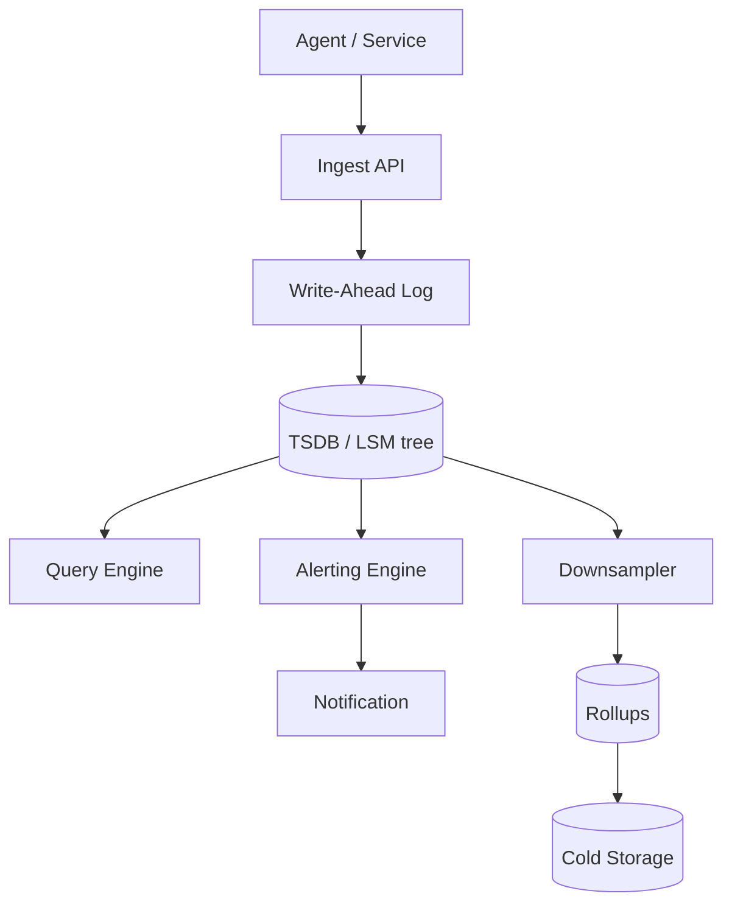

# Case Study: Metrics and Monitoring System

Try it yourself first using the [blank template](../templates/design-template.md). Then compare.

## 1. Requirements

**Functional**
- Ingest metrics from agents/services (time-stamped numeric values with tags)
- Query metrics over time ranges (aggregations: avg, p95, p99, sum, count)
- Define alert rules (e.g., "error rate > 5% for 5 minutes")
- Send notifications when alerts fire (email, pager, Slack)
- Dashboards for visualization

**Non-functional**
- High write throughput: millions of data points per second
- Efficient time-range queries over large retention windows
- Retention: hot data (raw) for days, downsampled data for months/years
- Alerting latency: detect and page within ~1 minute
- Eventually consistent for query results during ingestion spikes is acceptable

Out of scope for this round: log storage/search, distributed tracing, profiling, synthetic probing, log-based alerting.

## 2. Estimation

- 10,000 services, each emitting 100 metrics every 10 seconds → 100K data points/s per service group
- Realistic ingestion: 1-5 million data points/second average, 10M/s peak
- Each data point: ~100 bytes (metric name, tags, timestamp, value)
- Daily raw storage: 5M × 100 bytes × 86,400 = ~43 TB/day raw — too much; re-think.
- Realistic: raw hot retention 7 days (~300 TB), downsampled (1-minute rollups) retained 90 days (~20 TB), monthly rollups retained 2 years (~5 TB)
- Query volume: 1,000 active dashboards/alerts, each querying every 10-60 seconds

Conclusion: write throughput and storage cost dominate. Use a time-series DB (LSM tree) with downsampling/retention tiers, shard by metric, and pre-aggregate rollups for long ranges.

## 3. API

```
POST   /v1/metrics/ingest
       body: [ { "metric": "http_requests_total", "tags": { "endpoint": "/api", "status": "200", "service": "checkout" }, "timestamp": 1700000000, "value": 1 } ]
       returns: 204 No Content

GET    /v1/metrics/query
       params: query="avg(rate(http_requests_total{service=\"checkout\"}[5m]))", start=..., end=...
       returns: { "result": [ { "metric": "...", "values": [ [ts, val], ... ] } ] }

POST   /v1/alerts/rules
       body: { "name": "...", "condition": "...", "for": "5m", "severity": "critical", "notification": "..." }
       returns: { "rule_id": "..." }

GET    /v1/alerts
       returns: list of active alerts
```

Ingest uses batch writes (many data points in one request) to amortize overhead.

## 4. Data model

Access patterns:
- Ingest data points (write-heavy, append-only)
- Query time ranges for a metric (read-heavy, ordered by timestamp)
- Evaluate alert rules (periodic, read-heavy)

| Entity | Field | Notes |
|--------|-------|-------|
| DataPoint | metric_name + timestamp + tags | Composite key; time-ordered |
| DataPoint | value | Float/double |
| Rollup1m | metric_name + tags + 1-min bucket | avg, p95, p99, sum, count |
| Rollup1h | metric_name + tags + 1-hour bucket | Downsampled |
| AlertRule | rule_id (PK) | name, condition, for duration, severity |
| AlertState | rule_id | current state (firing/pending/resolved), last evaluated |

Storage choice: **time-series database (Prometheus-like, LSM-tree based)** for metrics — optimized for append-only writes and time-range reads. **Relational DB or Redis** for alert rules and state (smaller, needs strong consistency). Object storage for long-term cold retention.

## 5. High-level design



```text
Agent / Service -> Ingest API (batch) -> Write-Ahead Log -> TSDB (LSM tree, sharded by metric)
                                                                |
                                                        Query Engine
                                                                |
                                                        Alerting Engine (periodic evaluation)
                                                                |
                                                        Notification -> Pager / Email / Slack
                                                                |
                                                        Downsampler -> Rollups -> Cold Storage
```

**Ingest path:** agent batches data points → ingest API validates → write-ahead log (WAL) → TSDB memtable → flushed to disk (LSM tree) → replicated for HA.

**Query path:** query engine parses the query → identifies relevant shards and time ranges → fetches from memtable + disk (or rollups for long ranges) → aggregates → returns result.

**Alert path:** alerting engine evaluates rules on a schedule (e.g., every 30 seconds) → queries recent metrics → compares against thresholds → if firing for `for` duration, send notification.

**Downsampling:** raw data kept hot for 7 days; 1-minute rollups for 90 days; 1-hour rollups for 2 years. Old raw data is dropped or moved to cold storage.

## 6. Deep dive: storage engine and downsampling

This is the hard part. How do we store millions of points per second and query them efficiently?

| Decision | Options | Tradeoff |
|----------|---------|----------|
| Storage engine | LSM tree vs B-tree | LSM tree is write-optimized (append-only), ideal for metrics; B-tree is better for random reads/updates |
| Downsampling | Fixed rollups (1m, 1h) vs continuous aggregation | Fixed rollups are simple and fast; continuous aggregation is more flexible but complex |
| Retention | Time-based TTL vs size-based | Time-based is predictable; size-based adapts to storage pressure |
| Sharding | Shard by metric name vs hash of (metric + tags) | Shard by metric keeps a metric's data together (good for range scans); hash spreads load evenly |
| Cardinality | Limit tag combinations vs allow unbounded | Unbounded cardinality explodes storage (every unique tag combo = a new series); limit or use cardinality guards |

**Recommended:** LSM-tree TSDB sharded by metric name (or a hash of metric+tags for hot metrics). Fixed rollups: 1-minute for 90 days, 1-hour for 2 years. Enforce cardinality limits (reject metrics with too many tag combinations) to prevent storage explosion.

**TSD structure:** each series is a sequence of (timestamp, value) pairs sorted by time. LSM tree appends new points to a memtable, then flushes sorted runs (SSTables) to disk. Compaction merges old runs. Queries read the relevant time range across memtable + SSTables.

## 7. Bottlenecks and tradeoffs

- **Write throughput:** Millions of points/second can overwhelm a single ingest node. Mitigation: batch writes, shard the ingest API, write-ahead log + async flush to TSDB, horizontal ingest nodes.
- **High cardinality:** Too many unique tag combinations (e.g., `user_id` as a tag) explode series count. Mitigation: cardinality guards, put high-cardinality dimensions in logs instead, limit tags per metric.
- **Long-range queries:** Querying raw data over months is slow and expensive. Mitigation: use rollups (pre-aggregated 1m/1h data) for long ranges; raw only for recent hot data.
- **Alert evaluation load:** Thousands of rules evaluated every 30 seconds. Mitigation: stagger rule evaluation, cache recent metric values, only evaluate rules whose metrics changed.
- **Query storms:** A popular dashboard refreshed by many users creates query spikes. Mitigation: cache query results (short TTL), rate limit per user/dashboard, use rollups.
- **Retention cost:** Raw data is expensive. Mitigation: aggressive downsampling, move old data to cold storage (object storage), delete raw after retention.
- **Year 3 growth:** Ingestion and storage grow linearly with services. Mitigation: add TSDB shards, increase downsampling, tier storage, cardinality limits.
- **Monitoring and alerts:** Track ingestion rate (points/s), query latency (p99), TSDB disk usage, series count (cardinality), alert evaluation latency, and notification delivery. Page on ingestion backlog, disk pressure, or alerting delays.

## Follow-up questions to practice

1. How do you handle a metric with extremely high write volume (hot metric)?
2. What's the difference between a counter and a gauge, and how do you compute rates from counters?
3. How do you handle late-arriving data (out-of-order timestamps)?
4. How do you prevent alert storms (too many alerts at once)?
5. How do you store and query histograms (latency distributions)?
