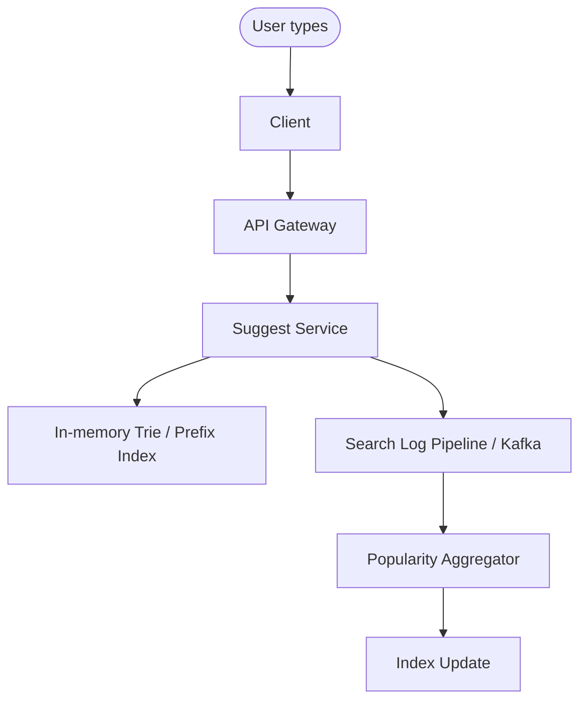

# Case Study: Search Autocomplete

Try it yourself first using the [blank template](../templates/design-template.md). Then compare.

## 1. Requirements

**Functional**
- As a user types, return a ranked list of suggestions matching the prefix
- Suggestions can be queries, products, users, or entities
- Rank by popularity, recency, and personalization
- Support prefix matching and fuzzy tolerance (optional)

**Non-functional**
- Very low latency: suggestions under ~50 ms at p99 (every keystroke)
- Fresh results: newly popular terms appear within seconds to minutes
- High throughput: one request per keystroke, so QPS is high relative to users
- Eventually consistent for suggestion freshness is acceptable

Out of scope for this round: full-text search, ranking by complex personalization, spell correction beyond prefix, image/video results, voice search.

## 2. Estimation

- 100 million DAU, each user issues 50 keystroke queries per day (avg 5 per search × 10 searches)
- 5B keystroke queries/day → ~58,000 requests/s average, ~200,000/s peak
- Suggestion corpus: ~100 million unique terms/phrases
- Average suggestion response: ~500 bytes (list of 5-10 suggestions with metadata)
- Read bandwidth: 200,000 × 500 bytes = 100 MB/s peak

Conclusion: read-heavy, ultra-low latency, high QPS. Precompute and cache top suggestions per prefix; serve from memory (Redis or in-process trie); update asynchronously from search logs.

## 3. API

```
GET    /v1/suggest?prefix=...&limit=10&user_id=...&locale=...
       returns: { "prefix": "...", "suggestions": [ { "text": "...", "score": 0.95, "type": "query" } ], "took_ms": "..." }
```

Prefix is the typed text so far. Limit caps the number of suggestions returned. User_id enables personalization. Locale/region for localized suggestions.

## 4. Data model

Access patterns:
- Prefix lookup: given "star", find all suggestions starting with "star" (read-heavy, every keystroke)
- Update: increment popularity of a term after a search (write-heavy, async)
- Fetch top-K per prefix (ranked)

| Entity | Field | Notes |
|--------|-------|-------|
| Suggestion | term (PK) | The suggestion text |
| Suggestion | prefix | All prefixes this term belongs to (derived) |
| Suggestion | popularity_score | Aggregated score (frequency + recency) |
| Suggestion | type | query, product, user, place |
| Suggestion | last_updated | For freshness |
| Suggestion | region, locale | Localization |

Storage choice: **in-memory trie / prefix tree** per region for ultra-low latency, backed by a search index (Elasticsearch/OpenSearch) or key-value store for the full corpus. Redis can hold hot prefixes; the full index lives on disk.

## 5. High-level design



```text
User types keystroke -> Client -> API Gateway -> Suggest Service
                                                    |
                                            In-memory Trie / Prefix Index
                                                    |
                                            Search Log Pipeline (Kafka)
                                                    |
                                            Popularity Aggregator -> Index Update
```

**Read path:** keystroke → suggest service → lookup prefix in in-memory trie → return top-K ranked suggestions from cache (Redis) or compute on the fly from the trie → return to client (<50 ms).

**Write/update path:** user submits a search → search log → Kafka → popularity aggregator increments term counts → periodically rewrite the trie / refresh hot prefixes → suggestions become fresh.

**Client optimization:** debounce keystrokes (wait 100-150 ms after the user stops typing before sending), cancel stale requests, and cache previous prefix results locally.

## 6. Deep dive: index structure and top-K per prefix

This is the hard part. How do we find top-K suggestions for any prefix in under 50 ms?

| Approach | How it works | Pros | Cons |
|----------|--------------|------|------|
| Trie (prefix tree) | Each node stores its subtree's top-K suggestions. Traverse to prefix node, return stored top-K. | O(prefix length) lookup, precomputed top-K | Memory heavy; top-K must be updated when popularity changes |
| N-gram index | Index all n-grams (2-3 char) of each term. Lookup prefix → candidate terms → rank on the fly. | Flexible, handles typos | More computation per query; ranking at query time adds latency |
| Finite State Transducer (FST) | Compact representation of terms with associated scores. | Very memory efficient, fast lookups | Harder to update dynamically; best for static corpora |
| Precomputed top-K per popular prefix | Cache top suggestions for the top million prefixes only; fall back to trie for the rest. | Simple, low memory for hot set | Long-tail prefixes are slower or less rich |

**Recommended:** Trie where each node stores its top-K (e.g., top 10) suggestions by popularity score. Read is O(prefix length) with no ranking at query time. Update asynchronously: search logs feed a popularity aggregator that rewrites trie nodes periodically (e.g., every minute for hot prefixes, hourly for long tail).

**Ranking:** score = f(frequency, recency, personalization, region). Keep it simple for the interview: frequency × recency decay. Personalization (user's past searches) can be a multiplier applied at query time for the top candidates only.

## 7. Bottlenecks and tradeoffs

- **Hot prefix:** Trending terms (e.g., a breaking news event) are queried millions of times. Mitigation: cache hot prefixes in Redis; replicate the trie across nodes; rate limit per prefix if needed.
- **Trie memory:** 100M terms × average length can be large. Mitigation: compress the trie (radix tree / FST), store only hot prefixes in memory and spill long-tail to disk, use shared prefixes.
- **Index freshness vs staleness:** Rewriting the trie on every search is too slow. Accept eventual consistency: hot terms update within minutes, long-tail within hours. State the SLA clearly.
- **Query volume:** One request per keystroke means QPS is 5-10× the search volume. Mitigation: client-side debouncing, request cancellation, local caching of previous results.
- **Personalization at scale:** Per-user ranking is expensive. Mitigation: personalize only the top 10-20 candidates after fetching them; keep the prefix lookup generic.
- **Year 3 growth:** Corpus grows to billions of terms; shard the trie by first character or by term hash; add regions; use FST for compression.
- **Monitoring and alerts:** Track suggest latency (p99/p999), cache hit rate, suggestions per query, empty-result rate, freshness lag (time from search to suggestion appearing), and QPS. Page on latency spikes or high empty-result rate.

## Follow-up questions to practice

1. How do you handle typos (e.g., "facebok" → "facebook")?
2. How do you support multi-language suggestions?
3. How do you rank suggestions when there is no popularity data yet (new terms)?
4. How do you handle prefixes that match millions of terms (e.g., "a")?
5. How do you prevent abuse (automated suggestion scraping)?
