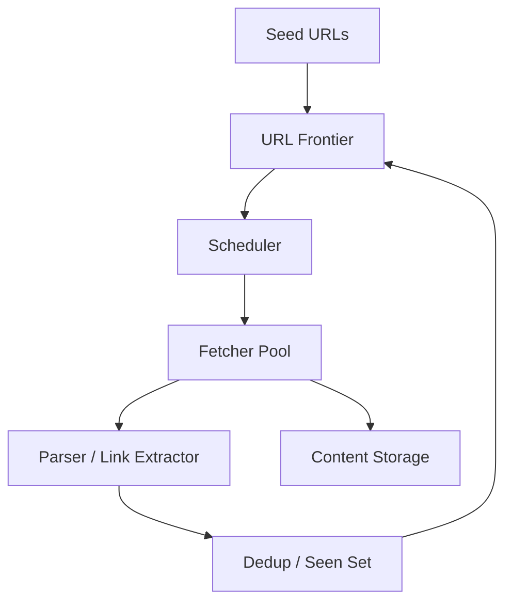

# Case Study: Web Crawler

Try it yourself first using the [blank template](../templates/design-template.md). Then compare.

## 1. Requirements

**Functional**
- Crawl URLs starting from seed URLs
- Extract links from each page and add them to the crawl queue
- Store page content and metadata
- Respect robots.txt (don't crawl disallowed paths)
- Avoid crawling the same URL twice (dedup)

**Non-functional**
- Politeness: don't overload any single host (respect crawl-delay, limit requests/second per host)
- Scalable: crawl billions of pages across many machines
- Durable: don't lose crawl state on node failure
- Eventually consistent: a page may be crawled with some delay

Out of scope for this round: JavaScript rendering, distributed index/query serving, sitemap parsing beyond HTML links, image/video crawling, authentication behind logins.

## 2. Estimation

- 1 billion pages to crawl initially
- 100 million new pages/day → ~1,200 pages/s average, ~5,000/s peak
- Average page size: 100 KB (HTML only)
- Daily storage: 100M × 100 KB = 10 TB/day — too much; re-think. Most pages are small and many are not recrawled often.
- Realistic: active index 1 PB, crawling 1-5 TB/day of HTML; with 3x replication ~3-15 PB
- Outgoing links per page: ~50 → link discovery frontier grows fast

Conclusion: the URL frontier (queue) and politeness per host are the core challenges, not raw storage. Use a distributed queue, partition by host, and dedup aggressively.

## 3. API

The crawler is largely a background system with minimal user-facing API:

```
POST   /v1/crawl/jobs
       body: { "seed_urls": ["..."], "max_depth": 3, "max_pages": 100000 }
       returns: { "job_id": "..." }

GET    /v1/crawl/jobs/{job_id}
       returns: { "job_id": "...", "status": "...", "pages_crawled": "...", "pages_queued": "..." }

GET    /v1/crawl/pages/{url_hash}
       returns: { "url": "...", "content": "...", "crawled_at": "...", "status_code": "..." }
```

Internal components communicate via message queues; the API above is for job control and status.

## 4. Data model

Access patterns:
- Enqueue/dequeue URLs for crawling (write-heavy, FIFO per host)
- Check if a URL was already crawled (dedup, read-heavy)
- Store page content after fetch (write-heavy)
- Update crawl frontier with discovered links (write-heavy)

| Entity | Field | Notes |
|--------|-------|-------|
| URLFrontier | url (PK) | Canonicalized URL |
| URLFrontier | status | queued, crawling, crawled, failed |
| URLFrontier | host | Partition key for politeness |
| URLFrontier | priority | Crawl priority score |
| URLFrontier | next_crawl_at | When to crawl next (respects politeness delay) |
| CrawledPage | url_hash (PK) | Content hash of URL |
| CrawledPage | url, content, content_type, status_code | Page data |
| CrawledPage | crawled_at | Timestamp |
| CrawledPage | outbound_links | Count or reference to discovered links |
| RobotsCache | host (PK) | robots.txt content + fetch time |
| RobotsCache | crawl_delay | Delay between requests to this host |

Storage choice: **distributed key-value store / wide-column store** for the URL frontier (high write throughput, point lookups by URL). **Object storage** for page content (large blobs). **Relational DB or Redis** for per-host politeness state and robots cache.

## 5. High-level design



```text
Seed URLs -> URL Frontier (distributed queue, partitioned by host)
                                |
                        Scheduler (politeness per host)
                                |
                        Fetcher Pool (many worker nodes)
                                |
                        Parser -> Link Extractor
                                |
                        Dedup (URL canonicalization + seen set)
                                |
                        URL Frontier (new links re-enqueued)
                                |
                        Content Storage (object storage)
```

**Crawl loop:** scheduler picks a host (respecting politeness), dequeues a URL from that host's queue → fetcher downloads the page → parser extracts links → dedup checks each link → new URLs go back to the frontier → page content stored.

**Politeness:** per-host rate limiting and crawl-delay from robots.txt. A host's queue is drained at a controlled rate; different hosts are crawled in parallel.

**Dedup:** URL canonicalization (lowercase host, strip trailing slashes, sort query params, remove fragments) + a "seen" set (Bloom filter + exact store) to avoid re-crawling.

## 6. Deep dive: frontier partitioning and politeness

This is the hard part. How do we crawl billions of pages without overwhelming any one server?

| Decision | Options | Tradeoff |
|----------|---------|----------|
| Frontier partitioning | Partition by host vs hash URL | Partition by host keeps politeness simple (one queue per host) but hot hosts skew; hash URL spreads load but politeness needs cross-node coordination |
| Politeness | Per-host rate limit + crawl-delay vs fixed delay per host | Rate limit + crawl-delay is more precise; fixed delay is simpler but less adaptive |
| Dedup | Bloom filter + exact store vs exact store only | Bloom filter is memory-fast but has false positives (may skip a URL); exact store is correct but slower |
| Crawl priority | PageRank-ish / freshness vs FIFO | Priority crawls important pages first but needs scoring; FIFO is simple but may crawl low-value pages |

**Recommended:** Partition the URL frontier by host. Each host's URLs live in one shard/queue, so politeness (rate limiting, crawl-delay) is enforced locally without cross-node coordination. Hot hosts are the skew problem — add more fetcher capacity and prioritize by host crawl budget.

**Dedup pipeline:** Bloom filter as a fast first check (in memory) → if not possibly seen, check exact seen-store → if new, mark as seen and enqueue. This balances speed and correctness.

**Recrawl policy:** Pages are recrawled based on change frequency (fresh pages more often), priority, and last-crawled timestamp. Store `next_crawl_at` in the frontier.

## 7. Bottlenecks and tradeoffs

- **Hot host:** A popular site (e.g., news, social media) generates millions of links and is crawled constantly. Mitigation: per-host crawl budget, prioritize, don't crawl the same host faster than its crawl-delay allows.
- **DNS resolution:** Resolving hostnames for millions of URLs is a bottleneck. Mitigation: DNS cache, batch DNS lookups, async resolution.
- **Duplicate content:** Many URLs serve the same content (tracking params, session IDs). Mitigation: canonicalization + content hash dedup; store content hash, not just URL.
- **Spider traps:** Infinite URL spaces (calendars, faceted navigation) waste the crawl budget. Mitigation: URL depth limits, parameter normalization, detect and trap recurring patterns.
- **Fetch failures:** Transient network errors, slow servers, timeouts. Mitigation: retries with backoff, per-host failure tracking, circuit breakers for repeatedly failing hosts.
- **Storage growth:** Billions of pages = petabytes. Mitigation: store only HTML (not images), compress, discard low-value pages, tier old crawls to cold storage.
- **Year 3 growth:** Frontier grows to tens of billions of URLs; shard by host across more nodes; use distributed consistent hashing for the frontier; add recrawl scheduling.
- **Monitoring and alerts:** Track pages crawled/s, frontier size, dedup rate, per-host crawl latency, robots.txt fetch failures, and storage growth. Page on politeness violations (too many requests to one host) or frontier backlog.

## Follow-up questions to practice

1. How do you prioritize which URLs to crawl first?
2. How do you handle a site that blocks your crawler (IP ban, CAPTCHA)?
3. How do you crawl dynamically loaded content (JavaScript)?
4. How do you detect and avoid spider traps?
5. How do you distribute the crawl across data centers?
