# Diagrams

Visual references for the core concepts. These render natively on GitHub. Each section names the module it belongs to.

## Module 01 — Scaling and traffic

### Load balancer flow

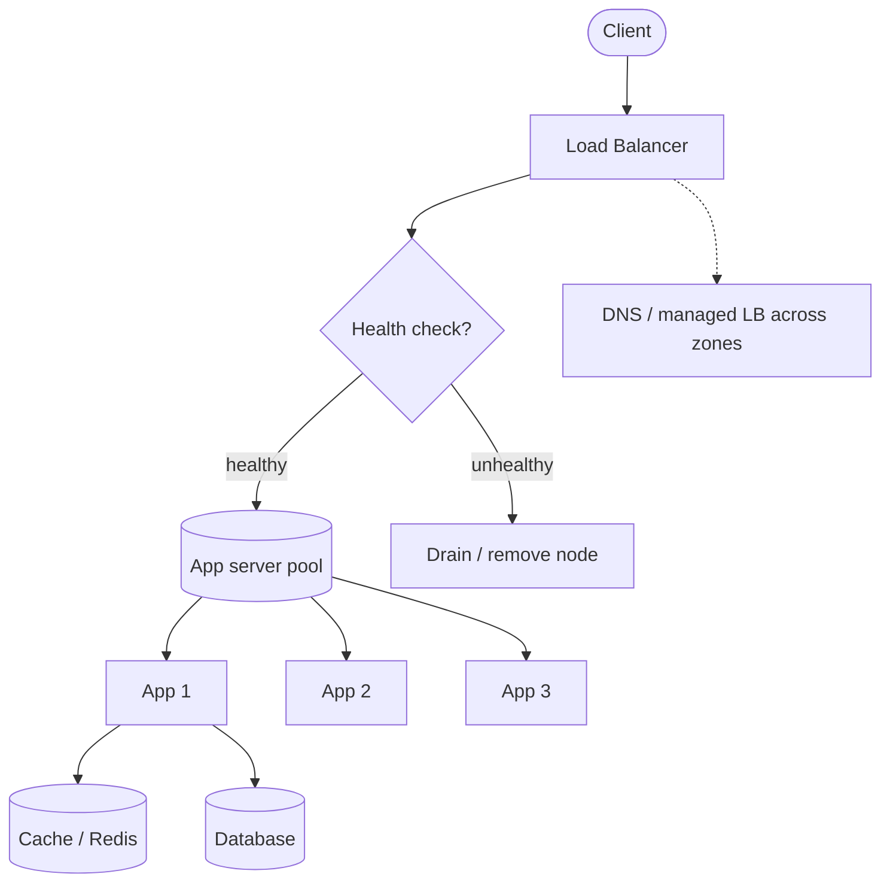

### Cache-aside pattern

```mermaid
flowchart LR
    App[Application] -->|1. Read key| Cache[(Cache)]
    Cache -- hit -->|2. Return value| App
    Cache -- miss -->|3. Read DB| DB[(Database)]
    DB -->|4. Return value| App
    App -->|5. Write to cache| Cache
```

## Module 02 — Data storage

### Leader-follower replication

```mermaid
flowchart TD
    Client([Client]) -->|Write| Leader[Leader]
    Leader -->|1. Write to log| WAL[(Write-ahead log)]
    Leader -->|2. Stream changes| F1[Follower 1]
    Leader -->|2. Stream changes| F2[Follower 2]
    Client -->|Read (eventual)| F1
    Client -->|Read (eventual)| F2
    Client -->|Read (strong)| Leader
```

### Consistent hashing ring

```mermaid
flowchart LR
    subgraph Ring["Hash ring (0 to 2^32-1)"]
        N1[Node A]
        N2[Node B]
        N3[Node C]
    end
    K1[Key "user:123"] -->|hashes to| N2
    K2[Key "user:456"] -->|hashes to| N3
    K3[Key "user:789"] -->|hashes to| N1
    N1 -.->|virtual nodes spread load| VN[VN1 ... VNk]
```

**How it works:** place nodes and keys on a ring; a key belongs to the next node clockwise. Add or remove a node and only the keys next to it move — unlike `hash(key) % N`, where nearly everything moves.

### Sharding strategies

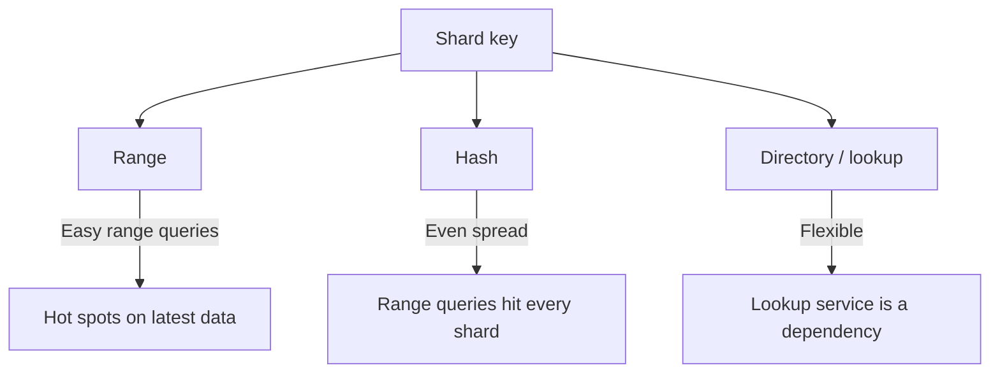

## Module 03 — Consistency and distributed data

### Quorum read and write (N=3, W=2, R=2)

```mermaid
flowchart TD
    Client([Client]) -->|Write| L[Leader]
    L -->|Replicate| R1[Replica 1]
    L -->|Replicate| R2[Replica 2]
    L -->|Replicate| R3[Replica 3]
    R1 -.->|ack| L
    R2 -.->|ack| L
    R3 -.->|ack| L
    L -- W=2 met -->|Ack write| Client
    
    Client2([Client]) -->|Read| R1
    Client2 -->|Read| R2
    Client2 -->|Read| R3
    R1 -- return version --> Client2
    R2 -- return version --> Client2
    R3 -- return version --> Client2
    Client2 -- R=2 met, pick newest -->|Return value| Client2
```

**Rule:** with N replicas, write to W and read from R. If R + W > N, reads overlap the latest write. Common setting: N=3, W=2, R=2.

### Leader election (Raft-style)

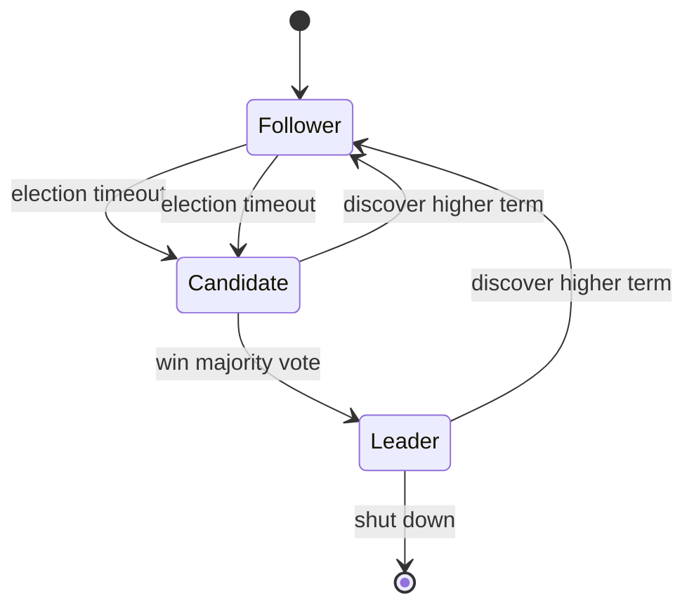

**Key ideas:** a majority (quorum) must agree, so a cluster of 2f+1 nodes survives f failures. Terms or epochs prevent split brain; fencing tokens stop an old leader from writing.

### Saga vs 2PC for checkout

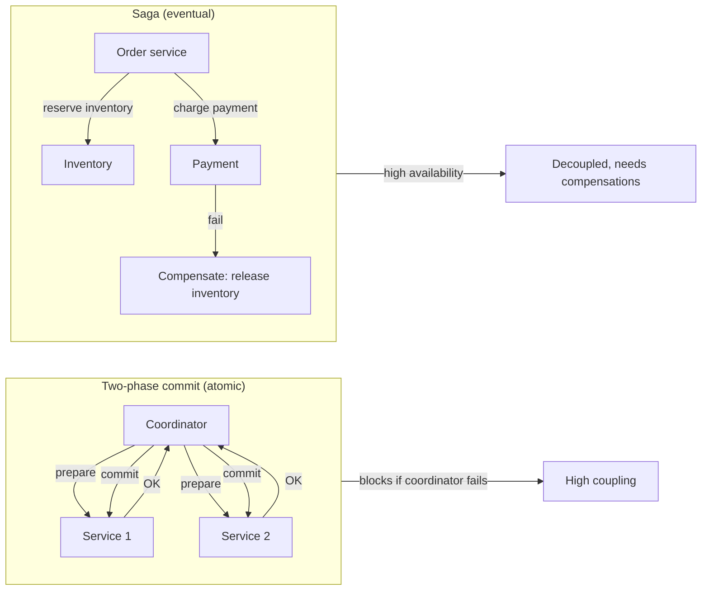

Use 2PC for a few systems in the same trust domain (money, inventory). Use sagas for microservices and long-running flows.

## Module 04 — Communication

### API gateway pattern

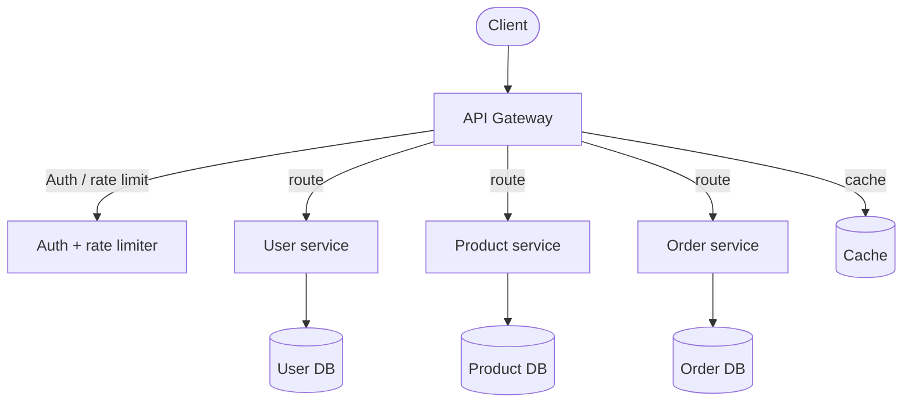

### Pub/sub

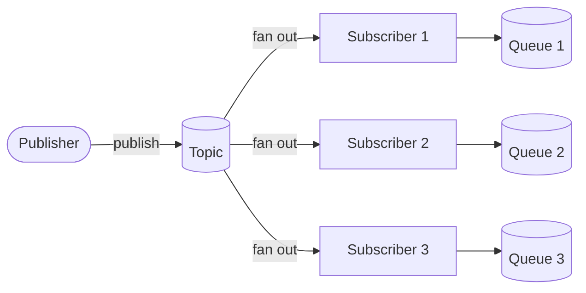

One publisher, many subscribers. Each subscriber has its own queue so slow consumers don't block others.

## Module 05 — Reliability and protection

### Circuit breaker states

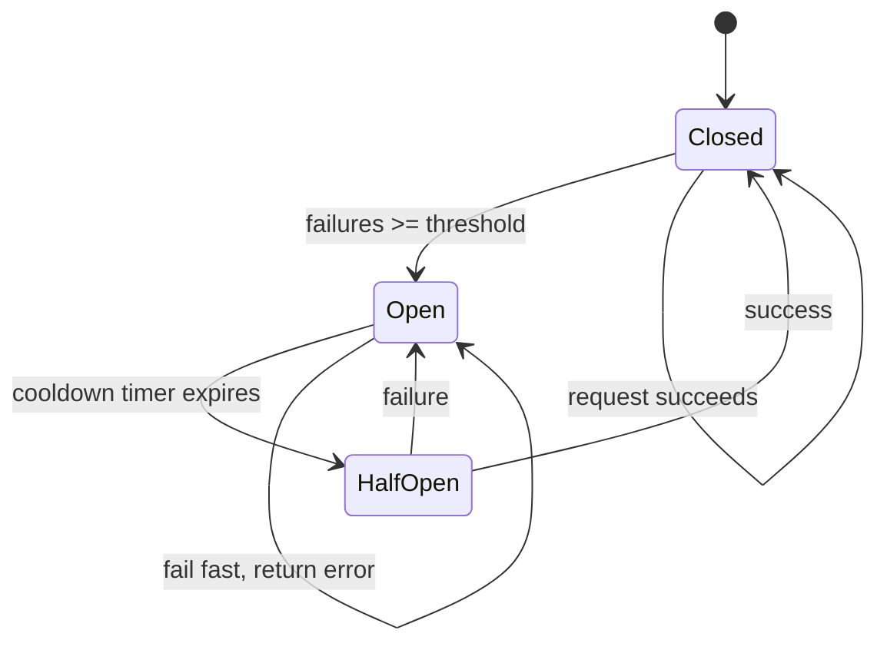

**Closed:** requests flow normally. **Open:** fail fast, don't call the dependency. **Half-open:** trial requests to test recovery.

### Token bucket rate limiter

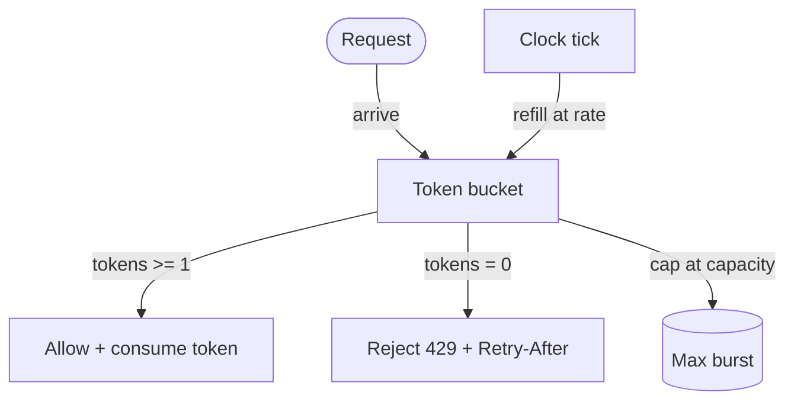

Refill tokens at a steady rate up to a capacity. Each allowed request consumes one token; when empty, reject.

## Module 06 — Estimation and metrics

### Estimation recipe

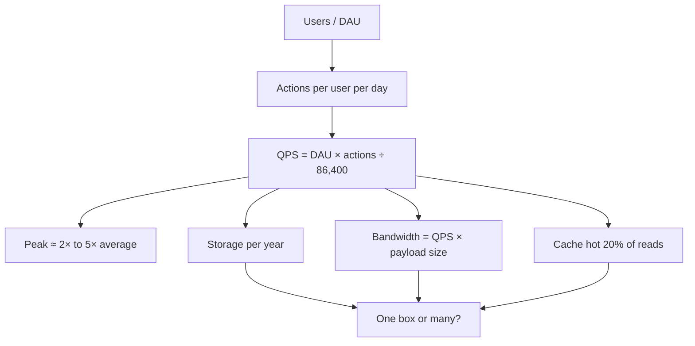

### Latency vs throughput (Little's Law)

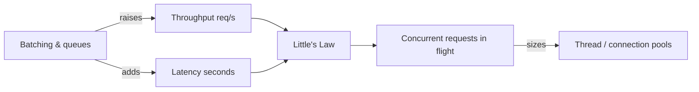

Measure p50 / p95 / p99 — not the average. Tail latency drives user experience.

## Module 07 — Observability and security

### Observability pipeline

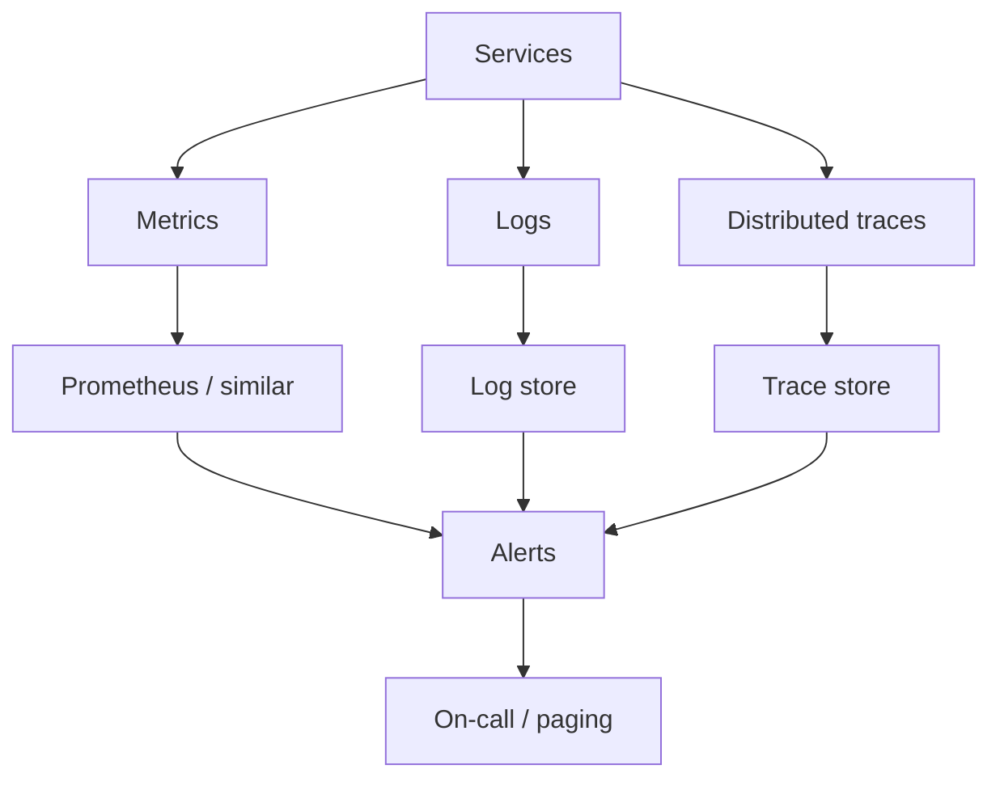

**Three pillars:** metrics (alerting), logs (debugging), traces (find slow services in a fan-out call).

## Module 05 — Idempotency (retry safety)

```mermaid
flowchart LR
    Client([Client]) -->|POST + Idempotency-Key| GW[Gateway]
    GW -->|check key| Store[(Processed keys)]
    Store -- seen before -->|return cached result| Client
    Store -- new -->|execute| Svc[Service]
    Svc -->|result + mark key| Store
```

Same idempotency key = same result, even if the client retries. Safe to retry after timeouts.

---

## How to use

- Read the diagram first, then read the matching module text for the tradeoffs.
- In an interview, you can sketch a simplified version of these on the whiteboard — boxes and arrows are enough; you don't need perfect Mermaid.
- Want to add or improve a diagram? See [CONTRIBUTING.md](../CONTRIBUTING.md).
